# Netflix Content Analysis

An exploratory data analysis of Netflix's catalog using Python (pandas, NumPy, matplotlib) on the Kaggle **Netflix Movies and TV Shows** dataset.

## Project goal
Understand what Netflix offers: how the catalog grew, which countries and genres dominate, how long movies run, and when new titles are added.

## Dataset
- **Source:** Kaggle, "Netflix Movies and TV Shows" (Shivam Bansal)
- **File:** `netflix_titles.csv`
- **Size:** 8,807 rows and 12 columns
- **Columns:** show_id, type, title, director, cast, country, date_added, release_year, rating, duration, listed_in, description

## Tools used
- **pandas:** loading, cleaning, grouping, counting
- **NumPy:** mean, median, standard deviation, percentiles, z-scores, `np.select`, `np.corrcoef`, `np.floor`
- **matplotlib:** charts

## How to run
1. Download `netflix_titles.csv` from Kaggle and place it in a `data/` folder.
2. Install the libraries:
   ```
   pip install -r requirements.txt
   ```
3. Run the analysis:
   ```
   python analysis.py
   ```
4. Find the 13 charts in the `charts/` folder.

## Project structure
```
project1/
├── README.md
├── requirements.txt
├── analysis.py
├── data/
│   └── netflix_titles.csv
└── charts/
```

## Data cleaning steps
| Issue found | What I did |
|---|---|
| 0 duplicate rows | Checked and removed duplicates (none found) |
| `director` missing in 2,634 rows, `cast` in 825, `country` in 831 | Filled with "Unknown" so no rows were lost |
| `date_added` missing in 10 rows, `rating` in 4 rows | Dropped these 14 rows (8,807 → 8,793 rows) |
| `date_added` stored as text | Converted to a real date, then extracted year and month |
| `duration` mixes minutes and seasons (e.g. "90 min", "2 Seasons") | Split into a number and a unit |

## Questions answered

| # | Question | Technique | Chart |
|---|----------|-----------|-------|
| 1 | Movies vs TV Shows | `value_counts` | `01_type_split.png` |
| 2 | Titles added per year | `groupby` | `02_titles_per_year.png` |
| 3 | Top countries | `split` + `explode` | `03_top_countries.png` |
| 4 | Top genres | `split` + `explode` | `04_top_genres.png` |
| 5 | Most common ratings | `value_counts` | `05_ratings.png` |
| 6 | Typical movie length | `describe`, histogram | `06_movie_duration.png` |
| 7 | Mean, median, std of movie length | NumPy | `10_movie_stats_boxplot.png` |
| 8 | Movie length percentiles | `np.percentile` | `11_percentiles.png` |
| 9 | Outlier movies | z-score | `12_outlier_zscores.png` |
| 10 | Short / Medium / Long movies | `np.select` | `07_length_categories.png` |
| 11 | Do newer movies run longer? | `np.corrcoef`, `np.polyfit` | `13_year_vs_length.png` |
| 12 | Average length by decade | `np.floor` + `groupby` | `08_length_by_decade.png` |
| 13 | Which month gets the most new titles? (my own question) | `value_counts` | `09_titles_by_month.png` |

## Key findings

**1. Movies dominate the catalog.** Of 8,793 titles, 6,129 (69.7%) are movies and 2,664 (30.3%) are TV shows.

**2. Netflix's catalog grew rapidly after 2015.** Only 82 titles were added in 2015, jumping to 428 in 2016 and 1,186 in 2017. Additions peaked in **2019 with 2,016 titles**, then fell to 1,879 in 2020 and 1,498 in 2021. The 2021 figure is partial, since the data ends on 25 September 2021.

**3. The US leads by a wide margin.** The United States has 3,684 titles, followed by India (1,046) and the United Kingdom (805). Canada, France and Japan complete the top six.

**4. International Movies and Dramas are the biggest genres.** International Movies has 2,752 titles and Dramas 2,426, followed by Comedies (1,674). Titles can carry several genres, so these counts overlap.

**5. Content skews towards mature audiences.** TV-MA (3,205 titles) and TV-14 (2,157) are the two most common ratings, well ahead of TV-PG (861) and R (799).

**6. A typical movie runs about 98 minutes.** The mean is 99.6 minutes (std 28.3) and the median is 98. The middle 50% of movies run 87 to 114 minutes, and 90% are under 133 minutes.

**7. Over half of all movies are 90 to 120 minutes.** Medium-length movies make up 3,147 titles (51.3%), Short (<90 min) 1,837 (30.0%) and Long (>120 min) 1,145 (18.7%).

**8. A few movies are extreme outliers.** 56 movies sit more than 3 standard deviations from the mean. The longest is 312 minutes and the shortest is just 3 minutes.

**9. Newer movies tend to be shorter.** The correlation between release year and movie length is **-0.206**, a weak negative relationship. The trend line fitted with `np.polyfit` drops about **0.6 minutes per release year**. By decade, the average length falls from 147.6 minutes (1960s) to 112.1 (2000s) and 93.6 (2020s).

## My own analysis: which month are the most titles added?

**Why I chose this question:** Release timing matters for any streaming service. I wanted to see whether Netflix adds new titles evenly through the year or favours certain months.

**How I did it:**
- Converted `date_added` to a date and extracted the month
- Counted titles per month with `value_counts()`
- Plotted the result with matplotlib

```python
month_names = ["Jan","Feb","Mar","Apr","May","Jun","Jul","Aug","Sep","Oct","Nov","Dec"]
month_counts = df["month_added"].dropna().astype(int).value_counts().sort_index()
month_counts.index = [month_names[m - 1] for m in month_counts.index]
save_bar(month_counts, "Titles added by month", "09_titles_by_month.png", ylabel="Titles")
```

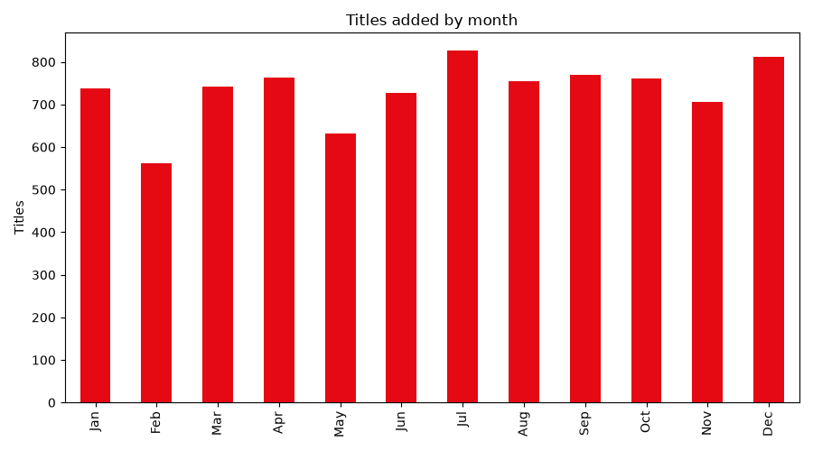

**What I found:**
- **July is the busiest month (827 titles)**, closely followed by **December (812)**. **February is the quietest (562)**, with May also low (632).
- Apart from February and May, every month falls between 705 and 827 titles, so additions are **fairly evenly spread** across the year, with slight peaks in July and December.

**Possible reasons (hypotheses, not proven):** The December peak may be tied to holiday viewing, and July to the summer break. February is the shortest month, which may partly explain its low count.

## Charts

**Q1. Movies vs TV Shows**

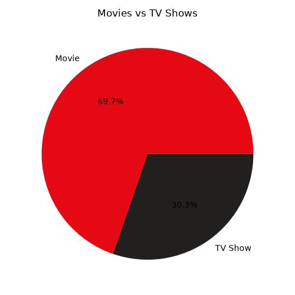

**Q2. Titles added per year**

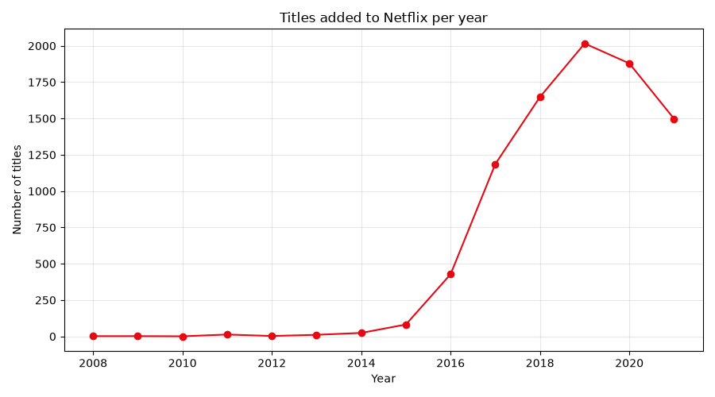

**Q3. Top countries**

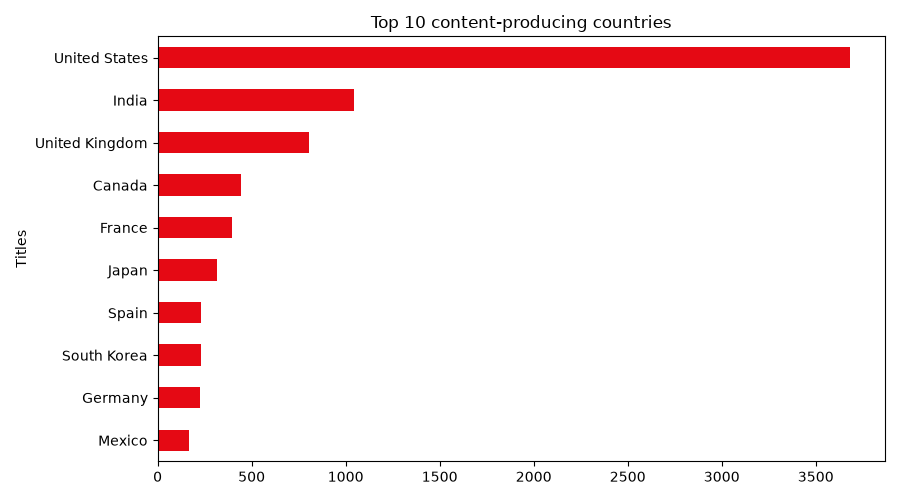

**Q4. Top genres**

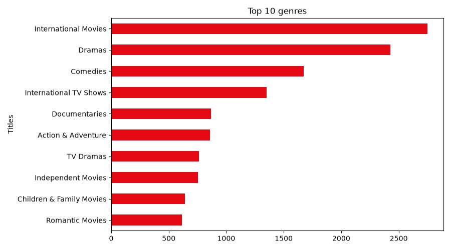

**Q5. Most common ratings**

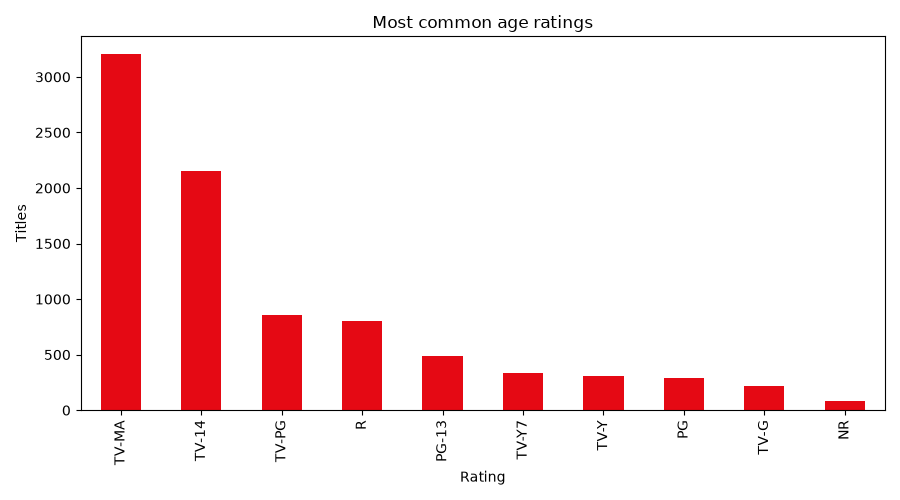

**Q6. Distribution of movie lengths**

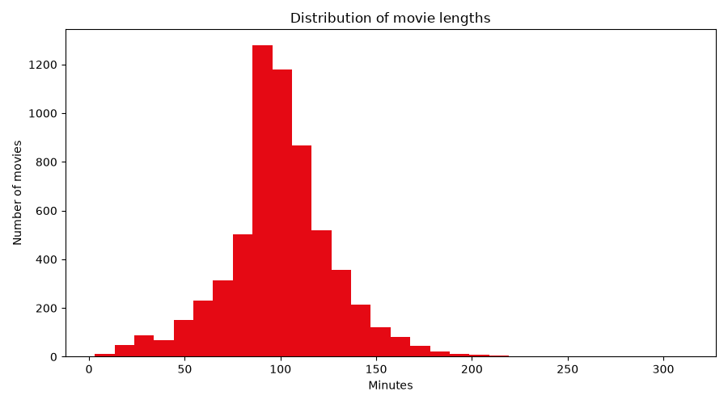

**Q7. Movie length statistics (box plot)**

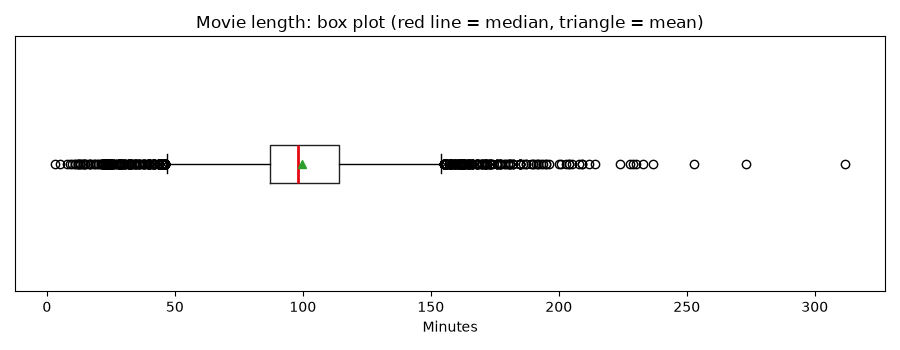

**Q8. Percentiles of movie length**

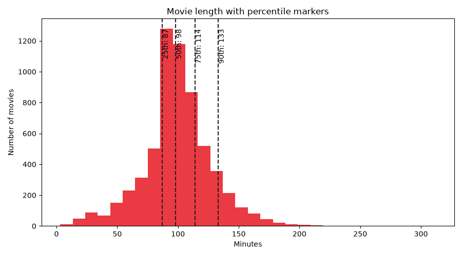

**Q9. Outliers (z-scores)**

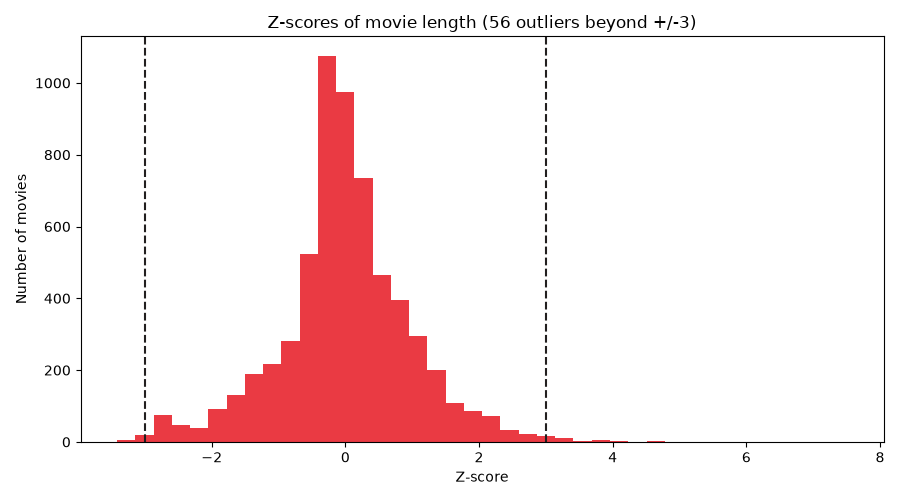

**Q10. Short, Medium and Long movies**

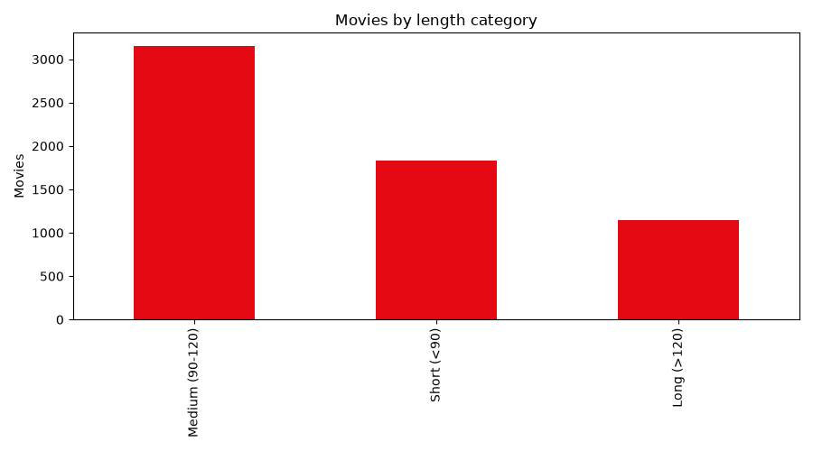

**Q11. Release year vs movie length**

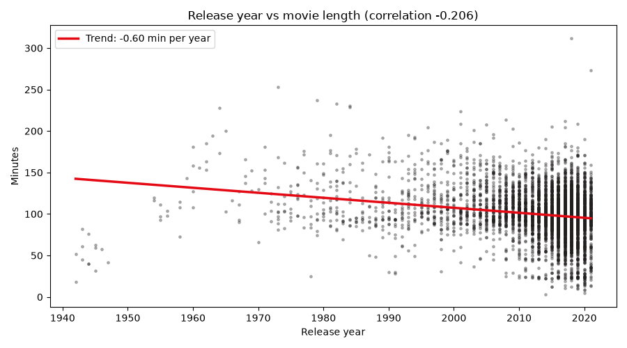

**Q12. Average movie length by decade**

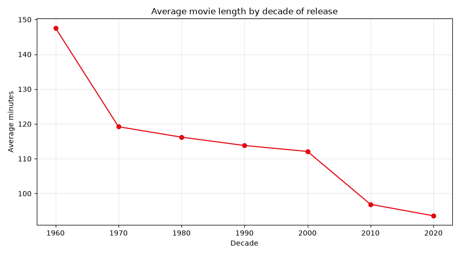

**Q13. Titles added by month (my own question)**


## Limitations
- The dataset is a snapshot with no viewership data, so popularity can't be measured.
- The data ends on 25 September 2021, so 2021 is incomplete. This also means January to September have one more year of data than October to December, which slightly favours the earlier months in the monthly chart.
- Titles can list several countries and genres, so each is counted once per mention.
- 831 titles have no country listed and are excluded from the country ranking.
- `date_added` is when a title arrived on Netflix, not when it was released.


## Author
Name : Raeel Nazir        ||      GitHub link : https://github.com/raeel-nazir
